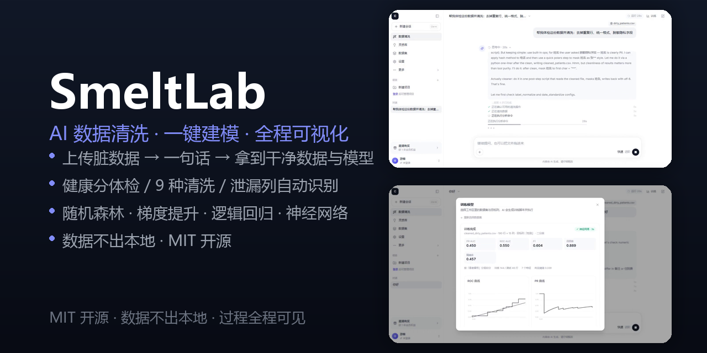
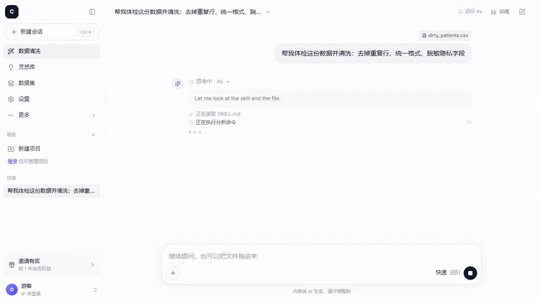
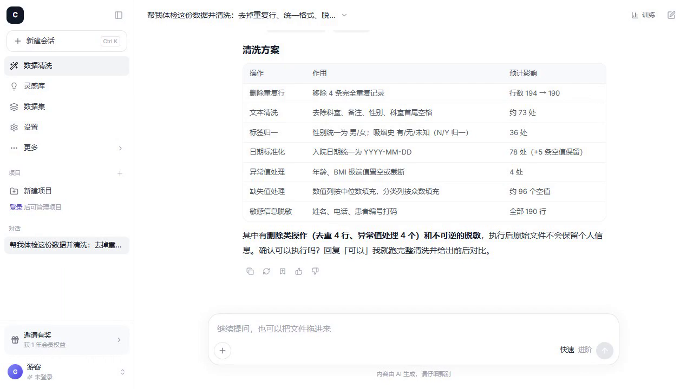
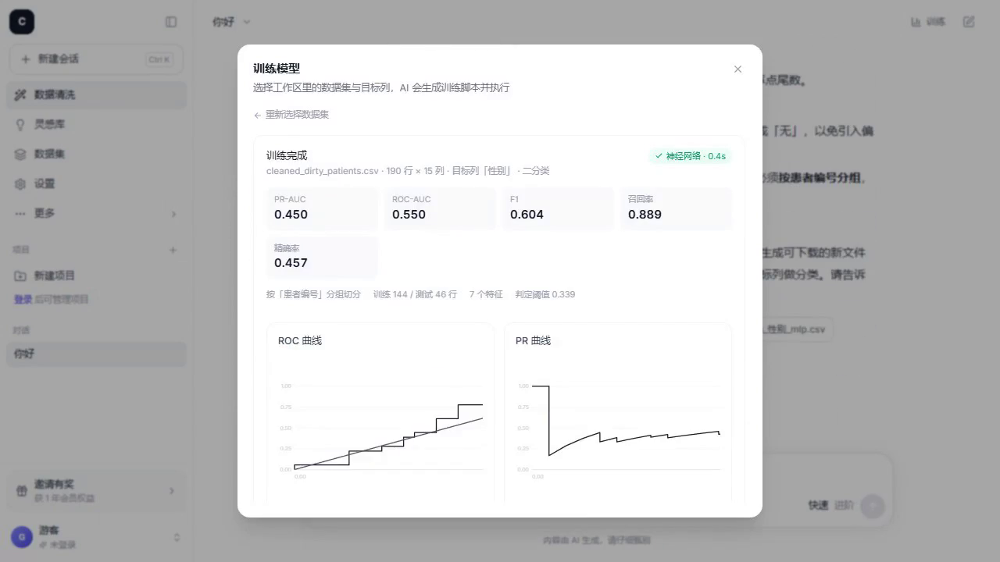
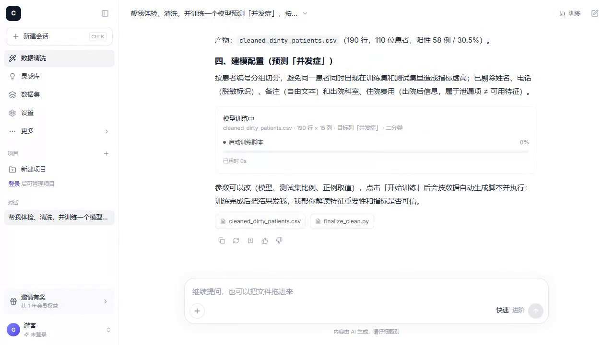
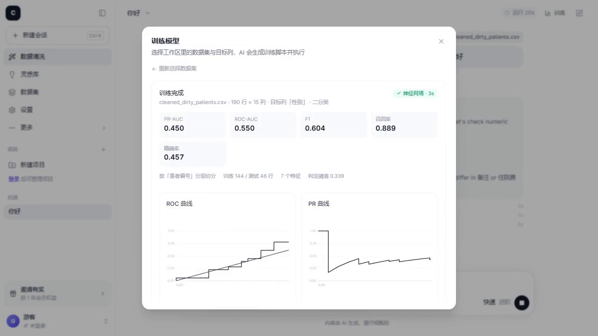
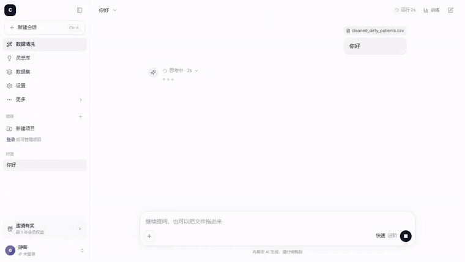

<div align="center">

# SmeltLab

**AI 数据清洗 + 一键建模：上传脏数据，说一句话，拿到能训练的干净数据和模型。**

*AI data cleaning + one-click modeling — dirty data in, trained model out.*

[](LICENSE)
[](https://www.python.org/)
[](https://nextjs.org/)
[](https://pola.rs/)
[](CONTRIBUTING)

</div>

<p align="center">
  
</p>

<p align="center">
  <a href="docs/demo-clean.gif">🎞 看清洗动图</a> ·
  <a href="docs/demo-train.gif">▶ 看建模动图</a> ·
  <a href="demo_videos/">📹 4 支演示视频</a> ·
  <a href="sample_data/dirty_patients.csv">📥 演示数据</a>
</p>

---

## 🤯 为什么做这个项目：洗数据比建模更耗时间

每个做机器学习的人都在同一件事上浪费时间：

- 拿到一份 CSV，先花半小时 `df.info()` 看缺失、看重复、看异常值；
- 日期有三种格式，性别有九种写法，`999` 和 `-1` 混在年龄里；
- 洗完才发现「住院费用」「出院科室」这种**事后信息**泄漏进了特征，指标虚高；
- 好不容易洗干净，配环境、切数据、训模型、画曲线又要一小时。

**SmeltLab 把这条链路压成三步：上传 → 一句话 → 出结果。**

> **为什么叫 SmeltLab**：冶炼（smelt）是把矿石炼成金属——脏数据进，能训练的模型出；Lab 是工作台——体检、清洗、训练、解读，一个界面走完。

---

## ✨ 功能特性：数据体检 · 自动清洗 · 一键 AutoML 建模

| | |
|---|---|
| 🩺 **数据体检** | 健康分 0-100 · 5 大类问题 · 列级画像 |
| 🧹 **一键清洗** | 9 种预置操作 · 改动前后 diff 审查 |
| 💬 **对话式清洗** | 说人话：「去掉重复行、统一格式、脱敏隐私字段」 |
| 👀 **过程可见** | 步骤实时播报 · 每步耗时 · 长任务进度条 |
| 🎯 **训练推荐** | 自动识别目标列 / 分组列 / 泄漏列 |
| 🚀 **一键建模** | 随机森林 · 梯度提升 · 逻辑回归 · 神经网络 |
| 📈 **结果可视化** | PR-AUC / ROC / 混淆矩阵 / 特征重要性 |
| 🤖 **AI 解读** | 指标能不能用、风险是什么、下一步做什么 |
| 🧩 **配方复用** | 清洗步骤存成 Recipe，同类数据一键套用 |
| 🔒 **本地优先** | 数据与产物留在本机，可全程离线使用预置功能 |

---

## 🖥 界面截图：对话式数据清洗与模型训练

<p align="center">
  
</p>

<p align="center"><em>过程实时可见 —— 不是黑箱等待</em></p>

<table>
  <tr>
    <td width="50%"></td>
    <td width="50%"></td>
  </tr>
  <tr>
    <td width="50%"></td>
    <td width="50%"></td>
  </tr>
</table>

<p align="center">
  
</p>

---

## ⚡ 快速开始：本地运行 FastAPI + Next.js

### 1. 克隆仓库

```bash
git clone https://github.com/<your-org>/smeltlab.git
cd smeltlab
```

<!-- 发布前把上面的 <your-org> 换成实际账号，并同步 docs/_banner.py 里的 footer -->

### 2. 启动后端（FastAPI · 端口 8000）

```bash
# macOS / Linux
cd backend
python -m venv .venv
source .venv/bin/activate
pip install -r requirements.txt
cp .env.example .env
python -m uvicorn app.main:app --reload --port 8000
```

```powershell
# Windows (PowerShell)
cd backend
python -m venv .venv
.venv\Scripts\Activate.ps1
pip install -r requirements.txt
Copy-Item .env.example .env
python -m uvicorn app.main:app --reload --port 8000
```

### 3. 启动前端（Next.js · 端口 3000）

```bash
cd frontend
npm install
npm run dev
```

### 4. 跑一遍 demo

打开 **http://localhost:3000**，把 [`sample_data/dirty_patients.csv`](sample_data/dirty_patients.csv) 拖进输入框，发一句：

> 帮我体检这份数据并清洗，然后训练一个模型预测「并发症」

<details>
<summary>🔑 想用「对话式清洗 / AI 解读」？</summary>

在 `backend/.env` 里配置一家模型服务商（二选一）：

```bash
AI_PROVIDER=glm            # 或 anthropic
GLM_API_KEY=sk-xxx         # 对应的 Key
```

> 不配 Key 也能完整体验：数据体检、9 种预置清洗、训练卡建模、指标曲线都不依赖 LLM。
</details>

---

## 🧭 三种使用方式：对话式 / 训练卡 / 命令行

| 方式 | 适合谁 | 入口 |
|---|---|---|
| 💬 **对话式** | 大多数人：说人话，全自动跑完 | 首页输入框直接提需求 |
| 🎛 **训练卡** | 想自己选模型/调参 | 对话页右上角「训练」→ 选数据集 → 开始训练 |
| ⌨️ **命令行** | 接进自己的流水线 | `python -m app.cli ...` |

```bash
cd backend

# 体检：健康分 + 问题清单 + 目标列候选 + 推荐训练配置
python -m app.cli profile --file ../sample_data/dirty_patients.csv

# 清洗：9 种操作可组合
python -m app.cli clean --file ../sample_data/dirty_patients.csv --ops dedup,missing,outlier,text_clean,pii_mask --out cleaned_patients.csv

# 看推荐配置
python -m app.cli schema --file cleaned_patients.csv

# 直接训练
python -m app.cli train --file cleaned_patients.csv --target 并发症 --group 患者编号 --time-budget 300

# 全部可用操作
python -m app.cli ops
```

---

## 🏗 架构：确定性清洗建模 + LLM 只做意图理解

```
+-------------------------------------------------------------------+
|Browser   Next.js 14 / React / Tailwind                            |
|  upload . chat . train card . charts . SSE progress               |
+-------------------------------------------------------------------+
                             |
                             | REST + SSE
                             v
+-------------------------------------------------------------------+
|FastAPI   app/api/routes                                           |
|  datasets . clean . train . agent . recipes . auth . settings     |
+-------------------------------------------------------------------+
                             |
                             v
+-------------------------------------------------------------------+
|Services   app/services                                            |
|  profiler        health score, issue detect, column profile       |
|  cleaner         9 preset ops + before/after diff                 |
|  trainer         light AutoML, grouped split, metrics, charts     |
|  trainer_codegen readable script + progress + JSONL log           |
|  training_jobs   run jobs, parse progress and result              |
|  pi_agent        local agent (pi CLI) -> visible step feed        |
+-------------------------------------------------------------------+
                             |
                             v
                             +--> Polars + scikit-learn  (local workspace)
```

**设计取舍**：清洗与建模全部用确定性代码（Polars / scikit-learn）完成，LLM 只负责「理解意图 + 解释结果」。指标可复现、过程可审计，不会出现模型编造数字。

---

## 🧰 技术栈

| 层 | 技术 |
|---|---|
| 前端 | Next.js 14 · React 18 · TypeScript · Tailwind CSS |
| 后端 | FastAPI · Pydantic · Polars · scikit-learn · joblib |
| Agent | pi CLI（本地 agent 引擎，JSONL 事件流） |
| 存储 | 本地文件工作区（SQLite 仅用于账号/配额） |

---

## 📁 目录结构

```
SmeltLab/
├── backend/
│   ├── app/
│   │   ├── api/routes/      # REST 接口（datasets / clean / train / agent ...）
│   │   ├── services/        # profiler / cleaner / trainer / trainer_codegen / pi_agent ...
│   │   └── cli.py           # 命令行入口：profile / clean / schema / train / ops
│   ├── skills/              # Agent 技能定义（数据清洗、自动建模）
│   └── requirements.txt
├── frontend/
│   ├── app/                 # 页面：对话 / 清洗 / 训练 / 配方 / 设置
│   └── components/          # UI 组件（训练卡、图表、Markdown 渲染 ...）
├── sample_data/             # 演示用脏数据集（194 行 × 15 列）
├── demo_videos/             # 4 支演示视频（横屏 + 竖屏）与录制脚本
└── docs/                    # PRD / 界面截图 / GIF 动图 / 社交预览横幅
```

---

## 🗺 Roadmap

- [ ] 多分类与多目标支持
- [ ] 超参数自动搜索（Optuna）
- [ ] Docker Compose 一键部署
- [ ] Recipe 社区市场

<details>
<summary>已上线</summary>

- [x] 数据体检（健康分 + 5 大类问题）
- [x] 9 种预置清洗操作 + diff 审查
- [x] 对话式清洗，过程可见
- [x] 训练卡：目标列 / 分组列 / 泄漏列自动推荐
- [x] 4 种模型 + 曲线 + 特征重要性 + AI 解读
- [x] JSONL 训练日志（可实时逐行读取）
</details>

---

## ❓ 常见问题（FAQ）

**Q：数据会被上传到云端吗？**

不会。数据体检、9 种预置清洗、训练卡建模、指标与曲线全部在本地进程内用 Polars / scikit-learn 完成，原始文件与产物留在本机（默认在 `backend/uploads` 下的会话工作区）。只有「对话式清洗」「AI 解读」这类功能会调用你在 `backend/.env` 里配置的模型服务商。

**Q：不配 API Key 能用到什么程度？**

核心链路完整可用：上传 → 体检（健康分 / 5 大类问题 / 列级画像）→ 勾选清洗操作 → 改动前后 diff 审查 → 训练卡建模 → PR-AUC / ROC / 混淆矩阵 / 特征重要性。缺的只是「用人话下指令」和「AI 解读指标」。

**Q：支持哪些数据格式？**

CSV、Excel（`.xlsx` / `.xls`）、JSON、JSONL、Parquet；导出结果支持 CSV / JSON，CLI 支持 CSV 与 Parquet。

**Q：清洗会覆盖原始数据吗？**

不会。清洗结果写入新文件，原始文件保持不变；每一步改动都能在 diff 里逐列对比后再确认，配方还可以存成 Recipe 复用到同类数据。

**Q：支持多分类和回归吗？**

当前支持二分类与回归（随机森林 / 梯度提升 / 逻辑回归 / 神经网络），并自动识别目标列、分组列和事后信息泄漏列。多分类与多目标在 Roadmap 中。

**Q：能处理多大数据量？**

面向本地单机的中小规模表格数据，规模主要受内存限制，尚未针对分布式或亿级数据做优化。有明确的大数据量需求欢迎提 Issue 说明场景。

---

## 🔍 和同类工具的区别

| 工具 | 它擅长什么 | SmeltLab 的不同 |
|---|---|---|
| pandas 手写脚本 | 完全可控，任何奇怪需求都能写 | 把「体检 → 清洗 → 建模 → 解读」串成一条链路，清洗步骤可存成 Recipe 复用，不必每份数据重写一遍 |
| OpenRefine | 人工逐条整理、聚类合并脏值 | 侧重自动体检，并与后续建模衔接，支持「说一句话」触发多步清洗 |
| ydata-profiling | 生成详尽的数据画像报告 | 画像只是第一步，后面直接接清洗与训练，不用换工具 |
| 云端 AutoML 平台 | 模型调优与算力强 | 本地优先，预置功能可全程离线运行，数据不出本机 |

---

## 🙏 致谢

站在这些项目的肩膀上：[Polars](https://pola.rs/) · [scikit-learn](https://scikit-learn.org/) · [FastAPI](https://fastapi.tiangolo.com/) · [Next.js](https://nextjs.org/) · [pi coding agent](https://github.com/earendil-works/pi)

---

## 🤝 贡献

欢迎 Issue 和 PR！约定与本地开发见 [CONTRIBUTING.md](CONTRIBUTING.md)。

也欢迎直接提需求：**你最想让 SmeltLab 自动处理的脏数据场景是什么？**

---

## 📄 License

[MIT](LICENSE) © SmeltLab contributors

---

<div align="center">

**如果这个项目帮你省下了洗数据的时间，请给一个 ⭐ Star，这对接下来的开发帮助很大。**

</div>
